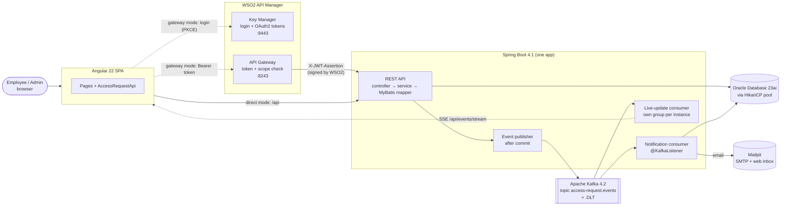
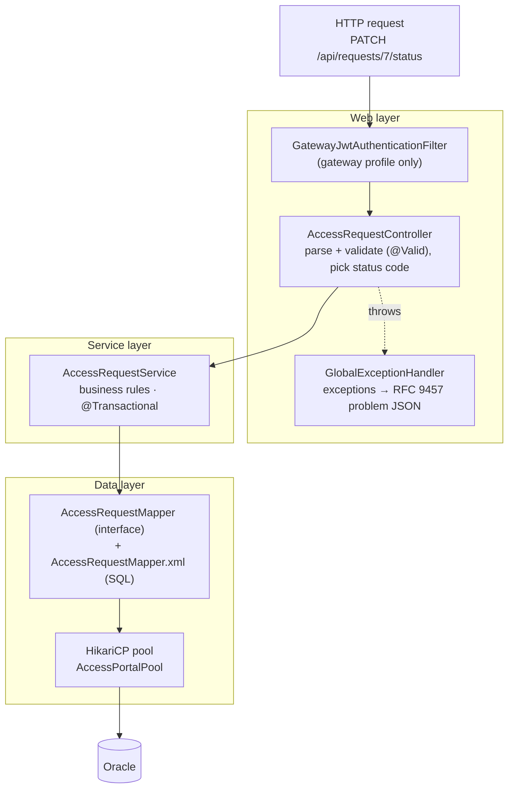
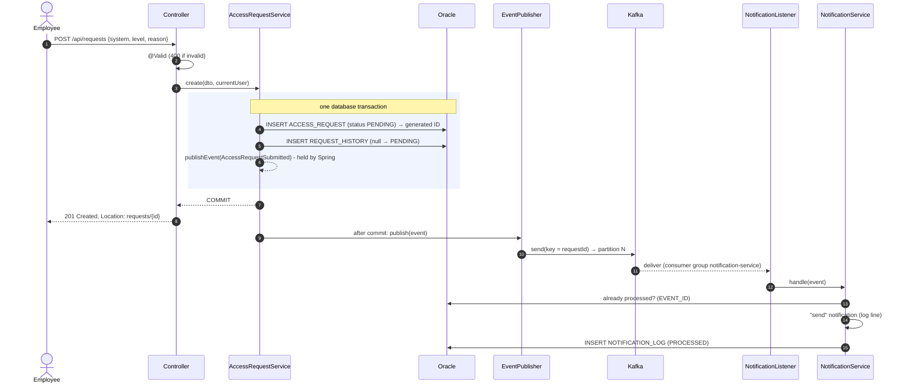
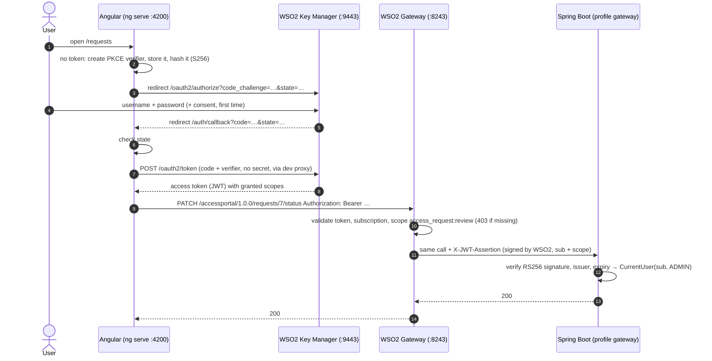
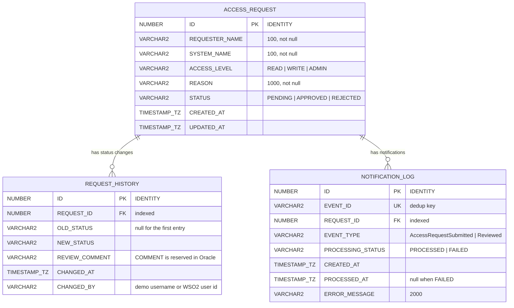
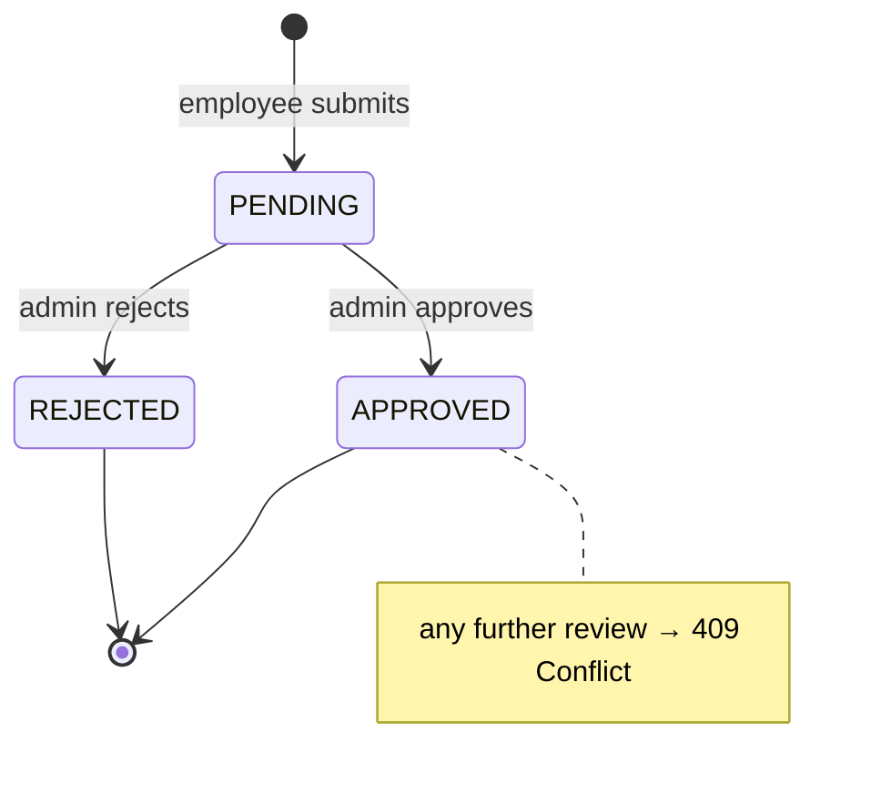

# Architecture

How the IT Access Request Portal is put together, how a request flows through it, and why it is built this way. For setup see the [README](../README.md); for the hands-on walkthrough see the [demo script](demo-script.md).

## 1. System overview

| Part | Technology | Responsibility |
|---|---|---|
| UI | Angular 22, standalone components, Reactive Forms, plain CSS | Pages; all HTTP calls in `AccessRequestApi`; demo-user switcher (direct mode) or WSO2 login with PKCE (gateway mode) |
| Gateway | WSO2 API Manager 4.7 (optional, Compose profile `gateway`) | Publishes the API, issues OAuth2 tokens, enforces scopes per resource, passes a signed JWT describing the caller to the backend |
| Backend | Spring Boot 4.1 on Java 21 | REST API, business rules, transactions, publishing events, consuming events |
| Persistence | MyBatis 3 (XML mappers) + HikariCP + Flyway | Explicit SQL; pooled connections; versioned schema |
| Database | Oracle Database Free 23ai | Requests, status history, notification log |
| Messaging | Apache Kafka 4.2 (KRaft, single node) | Asynchronous notification events, with a dead-letter topic |

There is **one** Spring Boot application (not microservices). The Kafka consumer lives in the same process as the API; it is asynchronous, not separately deployed.

## 2. Inside the backend: one request, layer by layer

| Layer | Knows about | Never does |
|---|---|---|
| Controller (`controller/`) | URLs, HTTP verbs, JSON, status codes, DTOs | SQL, business rules |
| Service (`service/`) | Business rules, transactions, domain objects | HTTP, SQL text |
| Mapper (`mapper/` + `resources/mapper/*.xml`) | SQL and column ↔ field mapping | Business rules |
| DTOs (`dto/request`, `dto/response`) | The public JSON contract | Database details |
| Domain (`domain/`) | One class per table row | Leaving the service layer |

## 3. Submitting a request (and what happens afterwards)

Reviewing works the same way, with one difference: the status update is `UPDATE … WHERE ID = ? AND STATUS = 'PENDING'`. If it updates 0 rows, the service answers **404** (no such request) or **409** (no longer pending). The `AND STATUS = 'PENDING'` makes check-and-update a single atomic step, so two admins reviewing at once cannot both win.

**Failure paths in this flow:**

| What fails | Result |
|---|---|
| Validation | 400, nothing written |
| History insert after the status update | Whole transaction rolls back; no event is sent (raised inside the transaction, sent only after commit) |
| Kafka unreachable after the commit | Request is saved and the response is 201; event lost and logged (**known gap**: an outbox would fix it) |
| Notification handler throws | Retried in place (1 + 2 retries, 1 s / 2 s); then a `FAILED` row is written and the record is copied to `access-request.events.DLT` |
| Same event delivered twice | Second one skipped (`UNIQUE(EVENT_ID)`) |

## 4. Gateway mode: login and a call through WSO2

The backend never sees the OAuth token. It trusts only WSO2's signed statement about the caller, so calling the backend around the gateway fails (401). Details and trade-offs: [wso2-setup.md](wso2-setup.md).

## 5. Data model

- Schema owner: Flyway, [`V1__create_schema.sql`](../backend/src/main/resources/db/migration/V1__create_schema.sql). Flyway records applied migrations in `flyway_schema_history`, and the app never alters tables itself.
- `TIMESTAMP WITH TIME ZONE` ↔ `java.time.OffsetDateTime`: values do not depend on the JVM or server time zone; the app writes UTC, truncated to microseconds (Oracle's precision).
- Allowed values are enforced twice: by Java enums and by `CHECK` constraints in the database.
- IDs are unique but not gap-free (Oracle caches IDENTITY values; a restart skips the rest of a block).

**Request lifecycle**

## 6. Configuration and profiles

| Setting | Direct mode (default) | Gateway mode |
|---|---|---|
| Spring profiles | `dev` | `dev,gateway` |
| `portal.auth.mode` | `demo-headers`: `X-Demo-User` / `X-Demo-Role` (**not security**) | `gateway-jwt`: WSO2-signed `X-JWT-Assertion` required |
| Angular | `npm start`, `/api` proxied to :8080 | `npm run start:gateway`, `/gateway` proxied to :8243 |
| Containers | `oracle`, `kafka` | + `wso2am` (profile `gateway`) |

Secrets and environment-specific values come from the git-ignored `.env` (create it with `node infra/init-env.mjs`). Generated files (WSO2 client id/secret, certificate) go to git-ignored locations.

## 7. Key decisions

| Decision | Why | Trade-off |
|---|---|---|
| **MyBatis, not JPA/Hibernate** | The SQL is visible and reviewable; Oracle-specific features (IDENTITY keys, `OFFSET … FETCH`, `MERGE`, `TIMESTAMP WITH TIME ZONE`) are used deliberately | More SQL to write and maintain by hand; no automatic dirty checking (see [concepts.md](concepts.md)) |
| **Conditional `UPDATE … AND STATUS = 'PENDING'`** | Race-free status transition without explicit locks | Needs a second query to tell 404 from 409 |
| **Publish events after commit** | A rolled-back change never produces a message | DB commit and Kafka send are not atomic: a crash in between loses the event (outbox = future fix) |
| **Kafka key = request id** | Per-request ordering (submitted before reviewed) | A failing record blocks its partition while retrying (bounded: 3 s) |
| **Idempotent consumer (`UNIQUE(EVENT_ID)`)** | Kafka is at-least-once | One extra lookup per event |
| **Kafka replaced RabbitMQ (2026-10-14)** | Team/company standard | Deviates from the original brief; RabbitMQ version kept on branch `feat/phase-3-messaging` |
| **Backend trusts only the gateway's signed JWT** | Calls around the gateway are useless; the backend never handles OAuth tokens | The backend needs WSO2's certificate (exported by the setup script) |
| **Actor = WSO2 user id, not username** | WSO2 4.7 passes only the id with JWT access tokens; the alternatives were broken or a custom WSO2 plugin | History shows ids in gateway mode |
| **PKCE public client in the browser** | No secret in JavaScript; an intercepted code is useless | Token kept in `sessionStorage` (XSS-readable); no refresh |
| **Testcontainers, no H2** | Oracle SQL and Kafka behaviour are tested on the real thing | Integration tests need Docker and take minutes on first run |

## 8. Known limitations and production improvements

| Area | Today (learning project) | For production |
|---|---|---|
| Event delivery | After-commit publish; lost if the app dies in between | **Transactional outbox** table + relay (or CDC), so DB change and event are atomic |
| Dead letters | Records parked in the DLT; replay not built or verified | Replay tooling, alerting on DLT growth |
| Security (direct mode) | Demo headers, anyone can impersonate anyone | Never deploy direct mode; gateway only, or Spring Security resource server |
| Tokens in the browser | `sessionStorage`, no refresh tokens | Backend-for-frontend (cookie session) or refresh-token rotation; CSP to limit XSS |
| Identity | WSO2 user id as actor | Custom gateway JWT claim (username/email) or a user directory lookup |
| WSO2 | Single node, H2 inside the container, self-signed certs, default keystore | External DB, real certificates, HA gateways, rotated keys, secrets in a vault |
| Kafka | 1 broker, no auth, no persistence volume | ≥ 3 brokers, replication factor 3, SASL/TLS, monitoring of consumer lag |
| Oracle | Container, single schema user | Managed DB, least-privilege runtime user (separate from the migration user), backups |
| Observability | Logs + Actuator (health, metrics) in dev | Structured logs, tracing (Micrometer + OpenTelemetry), dashboards and alerts |
| Delivery | No CI, local runs only | CI pipeline running unit + integration tests, container images, environment configs |
| Email | At-least-once delivery to Mailpit (local catcher); no SMTP auth or TLS configured | Real SMTP relay with TLS and credentials from a vault; outbox or a provider idempotency key for exactly-once |
| Live updates | SSE connections held in each instance's memory; events missed while disconnected are not replayed; no per-user filtering | Broadcast layer or sticky sessions at scale; resume with `Last-Event-ID`; filter events by what the user may see |
| Features | No pagination UI beyond prev/next, no audit export | Request expiry and revocation, reporting |
