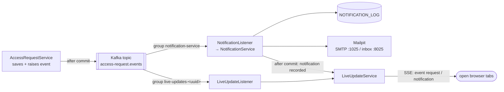

# Email notifications and live updates

Two features built on the same Kafka topic: real **emails** (caught locally by Mailpit) and **live updates** in the browser (Server-Sent Events). This is the clearest example in the project of why Kafka is used: one event, several independent reactions.

## The idea: one event, two consumers



Each **consumer group** keeps its own bookmark (offset) in the topic, so both consumers receive **every** event, independently. If email is slow or down, live updates still arrive, and the other way round. Adding a third reaction (say, provisioning accounts) would mean adding a third group, with no change to the code that saves requests.

## Email

| Event | Recipient | Subject |
|---|---|---|
| `AccessRequestSubmitted` | `it-admins@example.com` (`NOTIFICATIONS_ADMIN_ADDRESS`) | `New access request #55: GitLab` |
| `AccessRequestReviewed` | the submitter: `<username>@example.com` (`NOTIFICATIONS_USER_DOMAIN`) | `Your access request #55 was approved` |

- **Code:** [NotificationMailer](../backend/src/main/java/com/itaccess/portal/service/NotificationMailer.java) builds the message; [NotificationService](../backend/src/main/java/com/itaccess/portal/service/NotificationService.java) decides when to send it. The submitter comes from the request's first history entry.
- **Mailpit** (`docker compose up -d mailpit`) is a fake SMTP server: it accepts everything on port 1025 and shows it at **http://localhost:8025**. Nothing reaches real inboxes. In production you would point `MAIL_HOST` / `MAIL_PORT` at a real SMTP relay instead.
- **Order inside one database transaction:** first the `NOTIFICATION_LOG` row is written, then the email is sent. If sending fails (Mailpit down, or the `Legacy Mainframe` demo switch), the exception rolls the row back, and Kafka's error handler retries the event (3 attempts), then records `FAILED` and parks the event in `access-request.events.DLT`.
- **At least once:** if the email goes out but the commit then fails, the retry sends it again. Exactly-once email would need an outbox or a provider-side idempotency key. A duplicate *Kafka delivery* never sends a second email: the event is recognised by its `EVENT_ID` and skipped.
- In gateway mode the "username" is the WSO2 user id, so the submitter's address is `<user-id>@example.com` (see [wso2-setup.md](wso2-setup.md), *Actor = WSO2 user id*).

## Live updates (Server-Sent Events)

**SSE** is plain HTTP: the browser makes one GET request, and the server keeps the response open and writes a small text block whenever something happens:

```text
event:request
data:{"requestId":55,"eventType":"AccessRequestReviewed","status":"APPROVED","actor":"alice.admin","occurredAt":"…"}

event:notification
data:{"requestId":55,"eventId":"…","processingStatus":"PROCESSED"}

:heartbeat
```

| Piece | What it does |
|---|---|
| [LiveUpdateController](../backend/src/main/java/com/itaccess/portal/live/LiveUpdateController.java) | `GET /api/events/stream` returns an `SseEmitter`, which keeps the response open |
| [LiveUpdateService](../backend/src/main/java/com/itaccess/portal/live/LiveUpdateService.java) | Holds the open connections; `broadcast()` writes to all of them; a heartbeat every 20 s keeps proxies from closing idle connections; each stream ends after 5 min and the browser reconnects |
| [LiveUpdateListener](../backend/src/main/java/com/itaccess/portal/live/LiveUpdateListener.java) | The second Kafka consumer → `request` events; plus `notification` events after `NotificationService` commits |
| [live-updates.ts](../frontend/src/app/core/live-updates.ts) | One shared connection for the whole app, auto-reconnect with back-off, sets the **● Live** badge |
| [sse-parser.ts](../frontend/src/app/core/sse-parser.ts) | Turns the incoming text (which can arrive split anywhere) into messages |

**Who reacts in the UI:** the request detail page reloads its request (and shows *"Updated live: this request was approved."* if someone *else* changed it); the Notifications panel reloads its list; the request list and review queue re-run their current filter. All of them reload quietly, without a loading spinner.

**Why HttpClient instead of the browser's `EventSource`:** `EventSource` cannot send headers. Reading the stream through Angular's `HttpClient` means the usual interceptors add the demo-user headers or the WSO2 `Bearer` token, so the stream is protected exactly like the rest of the API, including through the gateway. `setup.mjs` publishes `GET /events/stream` with scope `access_request:read`.

**Why a consumer group per backend instance:** each instance only knows its *own* browser connections. With one shared group, Kafka would give each event to only one instance, and browsers connected to the others would miss it. A unique group per instance means every instance sees every event. `auto.offset.reset=latest` stops a restarted instance from replaying old events. Each restart leaves an unused group in Kafka, which Kafka deletes after its offset retention period (7 days by default).

## Try it

1. Start Mailpit along with the rest: `docker compose up -d oracle kafka mailpit`. Open **http://localhost:8025**.
2. Open http://localhost:4200 as **Ted L** and submit a request. Stay on its page; the header shows **● Live**.
3. In a **second browser window** (or a private window), open http://localhost:4200, switch to **Alice Admin**, and approve Ted's request.
4. **Ted's window**, without reloading: the status changes to APPROVED, the history gains the approval, the banner says *"Updated live"*, and the Notifications panel shows *Reviewed · PROCESSED*.
5. **Mailpit**: two emails, *"New access request #…"* to it-admins@example.com and *"Your access request #… was approved"* to ted.l@example.com.
6. Stop Mailpit (`docker compose stop mailpit`) and submit another request: after three attempts (about 3 s) the notification shows **FAILED** with *"Connection refused"*, and the event is in the dead-letter topic. Start Mailpit again (`docker compose start mailpit`), and new requests are emailed normally. Mailpit keeps mail in memory, so a restart empties its inbox.

Watch the raw stream with curl (direct mode): `curl -N http://localhost:8080/api/events/stream`.

## Verified

- Backend tests (real Kafka, Oracle and Mailpit via Testcontainers): the right two emails arrive in Mailpit for a submit + approve; an open SSE connection receives both `request` events and both `notification` events. With the push disabled on purpose, the live-update test fails, so it really checks the stream.
- In two real browsers (Edge): Ted's page switched to APPROVED about **0.9 s** after Alice clicked Approve; Alice's review queue showed Ted's new request within about **1 s**; no console errors.
- Through the WSO2 gateway: all four events of a submit + approve arrived in real time.

## Limitations

- **Email is at-least-once** (see above). Real SMTP needs authentication and TLS settings (`spring.mail.username`, `spring.mail.properties.mail.smtp.starttls.enable`), not configured here.
- **Events missed while disconnected are not replayed.** A tab whose stream dropped (sleep, network) gets later events after it reconnects, but not the ones in between. Pages reload their data when the user navigates, so this mostly matters for a page left open.
- **No per-user filtering:** every connected user receives every change (request id, status, actor, system name). That matches the app's current rule that everyone can list all requests; with per-user visibility, the stream would have to be filtered too.
- **In-memory connections:** each backend instance holds its own SSE connections (fine for this setup; at larger scale a broadcast layer or sticky sessions would be needed).
